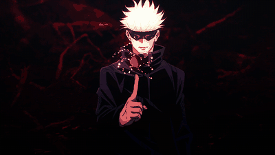

<em>"Entre linhas de código e projetos novos, sigo aprendendo um commit de cada vez."</em>

## Sobre mim

Fundador da **Betamin Development**, onde transformo ideias em soluções digitais.

<!-- SEMESTER:START -->
🎓 Atualmente no **5º semestre** de Engenharia da Computação na **Universidade de Fortaleza (UNIFOR)**.
<!-- SEMESTER:END -->

- Busco transformar aprendizado acadêmico em projetos práticos.
- Estou sempre desenvolvendo novas habilidades e explorando diferentes áreas da computação.
- Aberto a novas conexões, colaborações e oportunidades.

## Tecnologias

  
  
  
  
  
  
  
  
  

## 📚 Projetos e estudos

Cada repositório é um passo da minha evolução: entre softwares, aplicações web e jogos, aqui ficam os projetos que construo para colocar o aprendizado em prática.

[Explore meus repositórios](https://github.com/lorenzobetamin?tab=repositories)

<picture>
  <source media="(prefers-color-scheme: dark)" srcset="https://raw.githubusercontent.com/lorenzobetamin/lorenzobetamin/output/github-snake-dark.svg" />
  <source media="(prefers-color-scheme: light)" srcset="https://raw.githubusercontent.com/lorenzobetamin/lorenzobetamin/output/github-snake.svg" />
  
</picture>

## Contato

  

